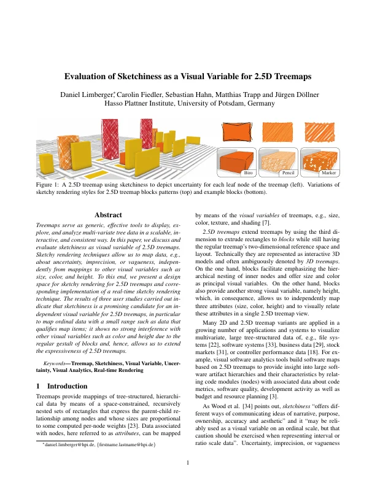
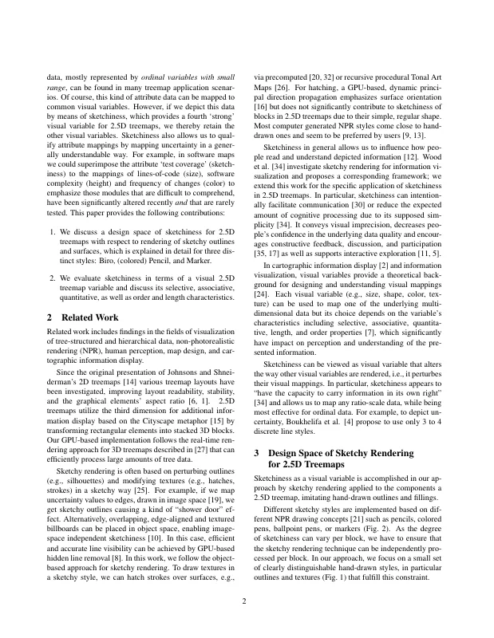
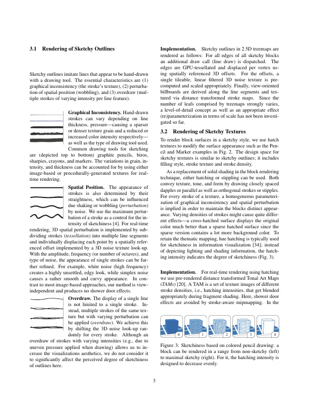
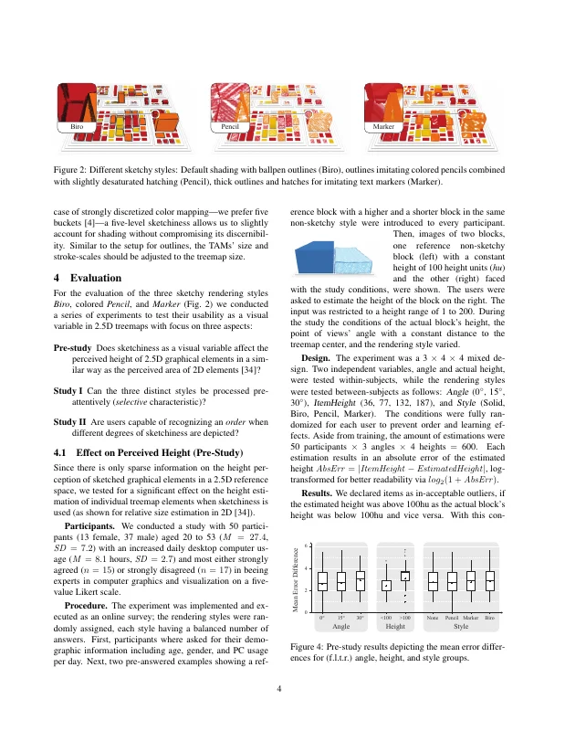
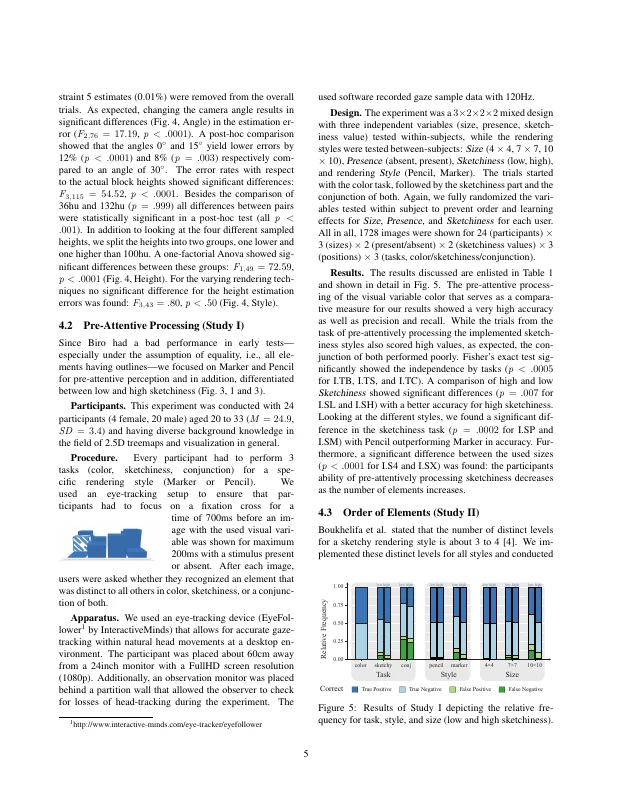
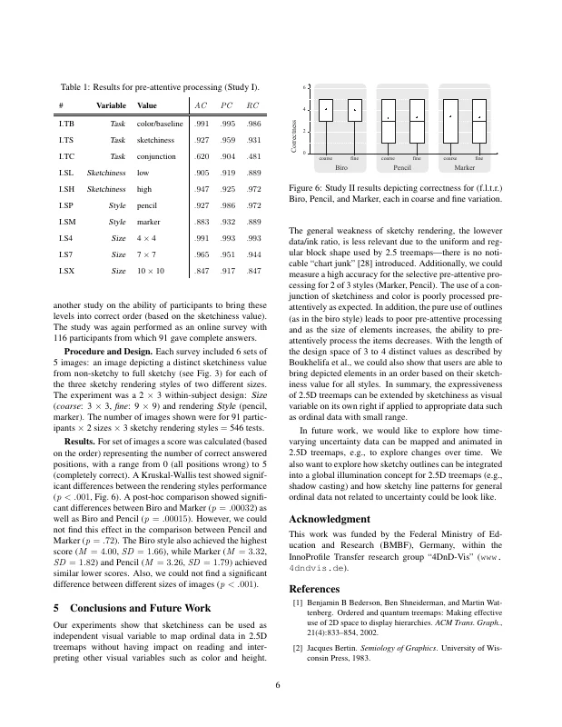
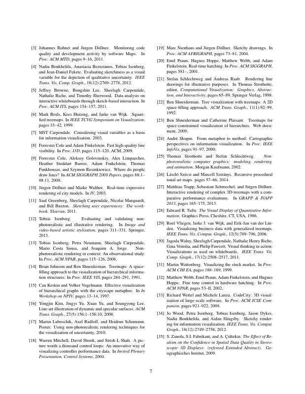

# Evaluation of Sketchiness as a Visual Variable for 2.5D Treemaps

[Daniel Limberger](https://orcid.org/0000-0002-9111-4809), [Carolin Fiedler](https://orcid.org/0000-0002-6781-9534), Sebastian Hahn, [Matthias Trapp](https://orcid.org/0000-0003-3861-5759), and [Jürgen Döllner](https://orcid.org/0000-0002-8981-8583)

*20th International Conference Information Visualisation (IV '16)*, July 19–22, 2016, Lisbon, Portugal. IEEE, pp. 183–189.

[](https://doi.org/10.1109/IV.2016.61) [](https://doi.org/10.5281/zenodo.24220782) [](https://www.researchgate.net/publication/301682636)

> Treemaps serve as generic, effective tools to display, explore, and analyze multi-variate tree data in a scalable, interactive, and consistent way.
> In this paper, we discuss and evaluate sketchiness as visual variable of 2.5D treemaps.
> Sketchy rendering techniques allow us to map data, e.g., about uncertainty, imprecision, or vagueness, independently from mappings to other visual variables such as size, color, and height.
> To this end, we present a design space for sketchy rendering for 2.5D treemaps and corresponding implementation of a real-time sketchy rendering technique.
> The results of three user studies carried out indicate that sketchiness is a promising candidate for an independent visual variable for 2.5D treemaps, in particular to map ordinal data with a small range such as data that qualifies map items; it shows no strong interference with other visual variables such as color and height due to the regular gestalt of blocks and, hence, allows us to extend the expressiveness of 2.5D treemaps.

<p><a href="limberger2016-sketchiness-as-submitted.pdf"></a> <a href="limberger2016-sketchiness-as-submitted.pdf"></a> <a href="limberger2016-sketchiness-as-submitted.pdf"></a> <a href="limberger2016-sketchiness-as-submitted.pdf"></a></p>
<details><summary>Remaining 3 pages</summary><p><a href="limberger2016-sketchiness-as-submitted.pdf"></a> <a href="limberger2016-sketchiness-as-submitted.pdf"></a> <a href="limberger2016-sketchiness-as-submitted.pdf"></a></p></details>

## Contents

- [`src/`](src/) – LaTeX sources of the camera-ready version (IV conference template: `article` class with the IV page setup in `main.tex`)
- [`limberger2016-sketchiness-as-submitted.pdf`](limberger2016-sketchiness-as-submitted.pdf) – camera-ready PDF (author's copy from ResearchGate, July 2016, cover page removed)
- [`build.sh`](build.sh) – reproducible build with TeX Live 2013 (podman or docker)
- [`preview/`](preview/) – page previews for this README

## Build

```bash
./build.sh        # → build/main.pdf
```

`limberger2016-sketchiness-as-submitted.pdf` was built with MiKTeX (pdfTeX 1.40.14); the build with TeX Live 2013 (same pdfTeX version) reproduces it pixel-identically.
The only difference is the "View publication stats" footer that ResearchGate added at the bottom of the last page.

## Versions

- [`v1.0-camera-ready`](https://github.com/dl-archive/article.2016-iv-sketchiness-treemaps/tree/v1.0-camera-ready) – sources as submitted to IEEE
- [`v1.1-revised`](https://github.com/dl-archive/article.2016-iv-sketchiness-treemaps/tree/v1.1-revised) – author's revised version (2026-11-14): spelling, grammar and hyphenation fixes, see [Revisions](#revisions)

## Revisions

`v1.1-revised` (2026-11-14) corrects errors in the camera-ready version without changing its content or layout (same page and column breaks).
Every page carries the note "Author's revised version (2026-11-14). Version of record: https://doi.org/10.1109/IV.2016.61".

- Spelling: "perturbs" (was "perturbes"), "being", "noticeable", "leaves" (was "leafs"), "lowered" (was "lowever"), "unacceptable", "Johnson and Shneiderman's", "2.5D treemaps" (was "2.5 treemaps").
- Grammar and word choice: "a corresponding implementation", "by means of space-constrained, recursively nested sets", "point out", "propose", "significantly impact", "the components of a 2.5D treemap", "influenced by shaking", "the visualization's aesthetics", "linearly filtered", "the blocks' distinct appearance", "sparsely hatched", "maximally sketchy", "participants were asked", "the point of view's angle", "the number of estimations was", "distinct from", "at 120 Hz", "within-subjects", "listed in", "the participants' ability", "of whom", "fully sketchy", "The number of images shown was", "For each set, a score", "correctly answered", "as an independent visual variable", "having an impact", "into an order", "in its own right", "could look like", and missing commas.
- Hyphenation and typography: computer-generated, procedurally generated, distance-transformed, $\log_2$, "Biro style".

## Citation

```bibtex
@InProceedings{limberger2016-sketchiness,
  author    = {Limberger, Daniel and Fiedler, Carolin and Hahn, Sebastian and Trapp, Matthias and D{\"o}llner, J{\"u}rgen},
  title     = {Evaluation of Sketchiness as a Visual Variable for 2.5D Treemaps},
  booktitle = {20th International Conference Information Visualisation},
  year      = {2016},
  series    = {IV~'16},
  publisher = {IEEE},
  pages     = {183--189},
  doi       = {10.1109/IV.2016.61},
  isbn      = {978-1-467389-42-6},
}
```
